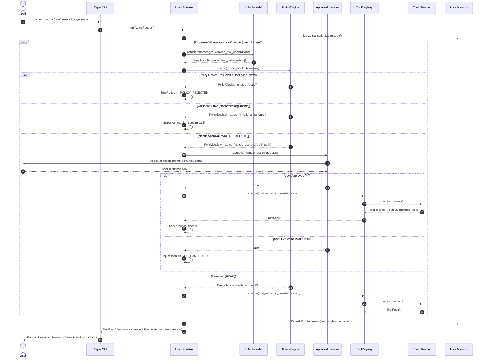

# TermiCode AI — Architecture

TermiCode AI is a terminal coding assistant built on the principle of **strict authority separation**. The language model is an untrusted planner that proposes actions; deterministic software boundaries evaluate policy, restrict filesystem access, enforce user approvals, and execute allowlisted commands.

---

## 1. Architectural Principles

- **Untrusted Proposer:** The LLM never receives direct filesystem handles, shell access, or network authority. It generates structured action proposals (`ProposedAction`) validated by deterministic code.
- **Deterministic Boundary:** Safety rules, path containment, executable allowlists, and approval gates are enforced in Python code that the model cannot bypass or reconfigure.
- **Human-in-the-Loop Authority:** Every mutating operation (writing a file, applying a patch, or running a subprocess) requires explicit user confirmation with a workspace-relative preview.
- **Single-Agent Runtime:** One auditable, bounded runtime executes all tasks, switching behavior and tool access based on explicit workflow profiles rather than spawning uncoordinated autonomous agents.
- **Auditable Local Memory:** Transcripts and compact summaries are persisted exclusively under `.termicode/` within the approved workspace root, with automatic secret redaction.

---

## 2. Component Diagram

```text
┌────────────────────────────────────────────────────────────────────────┐
│                               User / CLI                               │
│       task · workflow · --workspace · --dry-run · --plan · approval    │
└───────────────────────────────────┬────────────────────────────────────┘
                                    │
┌───────────────────────────────────▼────────────────────────────────────┐
│                               CLI Layer                                │
│       src/termicode/cli.py · console.py · rich formatting & prompts    │
└──────────────────┬───────────────────────────────┬─────────────────────┘
                   │                               │
┌──────────────────▼────────────┐     ┌────────────▼─────────────────────┐
│   Workspace Boundary & Safety │     │         Workflow Profile         │
│   src/termicode/workspace.py  │     │   src/termicode/agent/workflows  │
│   resolve_safe · block .env   │     │   allowed tools · risk · budget  │
└──────────────────┬────────────┘     └────────────┬─────────────────────┘
                   │                               │
                   └───────────────┬───────────────┘
                                   │
┌──────────────────────────────────▼─────────────────────────────────────┐
│                          Single Agent Runtime                          │
│       src/termicode/agent/runtime.py · bounded propose-validate loop   │
│       step limits · repair counters · Ctrl+C-safe cancellation         │
└──────────────────┬───────────────────────────────┬─────────────────────┘
                   │                               │
┌──────────────────▼────────────┐     ┌────────────▼─────────────────────┐
│          LLM Provider         │     │          Policy Engine           │
│   src/termicode/providers/    │     │   src/termicode/agent/policy.py  │
│   OpenAIProvider · FakeProvider│    │   evaluates every tool proposal  │
│   typed tool calls · redaction│     │   permit · deny · needs_approval │
└───────────────────────────────┘     └────────────┬─────────────────────┘
                                                   │
                                      ┌────────────▼─────────────────────┐
                                      │          Tool Registry           │
                                      │   src/termicode/tools/registry   │
                                      │   schemas · risk levels · execute│
                                      └────────────┬─────────┬───────────┘
                                                   │         │
                                      ┌────────────▼──┐   ┌──▼───────────┐
                                      │   Filesystem  │   │Secure Command│
                                      │   read · write│   │runner/ · git │
                                      │   diff preview│   │pytest · ruff │
                                      └────────────┬──┘   └──┬───────────┘
                                                   │         │
                                      ┌────────────▼─────────▼───────────┐
                                      │           Local Memory           │
                                      │   src/termicode/agent/memory.py  │
                                      │   .termicode/transcripts/ (JSONL)│
                                      │   .termicode/summaries/ (JSON)   │
                                      └──────────────────────────────────┘
```

---

## 3. Component Responsibilities

| Component | Module | Responsibility | Key Interface |
|---|---|---|---|
| **CLI Layer** | `termicode.cli` | Parses commands, options, and flags; handles interactive approvals with diff previews; renders Rich summaries. | `app()`, `_execute_workflow()` |
| **Workspace Boundary** | `termicode.workspace` | Canonicalizes workspace root; strictly confines all path resolution; blocks path traversal and sensitive files (`.env`, `.git`, SSH keys). | `WorkspaceBoundary.resolve_safe(path)` |
| **Workflow Profiles** | `termicode.agent.workflows` | Defines tool allowlists, read/write/execute permissions, step budgets, behavioral instructions, and success criteria for each task mode. | `get_workflow_profile(name)` |
| **Policy Engine** | `termicode.agent.policy` | Independently evaluates proposed model actions; generates diffs and previews; returns `permit`, `deny`, or `needs_approval`. | `PolicyEngine.evaluate(action, profile, boundary)` |
| **Agent Runtime** | `termicode.agent.runtime` | Executes the propose-validate-approve-execute cycle; enforces step limits and repair budgets; logs events; records telemetry. | `AgentRuntime.run(request) -> RunResult` |
| **Provider Adapter** | `termicode.providers` | Formats typed requests into OpenAI-compatible completions; strictly validates structured tool calls; redacts API keys and tokens. | `LLMProvider.complete(request)` |
| **Tool Registry** | `termicode.tools.registry` | Stores typed tools; exports Pydantic argument schemas to model declarations; enforces risk levels (`READ`, `WRITE`, `EXECUTE`). | `ToolRegistry.execute(name, args, context)` |
| **Filesystem Tools** | `termicode.tools.filesystem` | Safe workspace-contained file operations (`list_files`, `read_file`, `search_text`, `write_file`, `apply_patch`). | `BaseTool.run(args, context)` |
| **Command Runner** | `termicode.runner` | Executes allowlisted binaries (`python`, `pytest`, `ruff`, `mypy`, `git`) with `shell=False`, argument arrays, timeouts, and output limits. | `CommandRunner.run(argv, cwd, ...)` |
| **Local Memory** | `termicode.agent.memory` | Stores chronological JSONL transcripts and structured compact task summaries strictly under `<workspace>/.termicode/`. | `LocalMemory.save_summary()`, `get_summary()` |

---

## 4. Lifecycle of a Task



---

## 5. Local Memory Architecture

All persistence is local to the active workspace:

```text
<workspace>/
└── .termicode/
    ├── transcripts/
    │   ├── run_a1b2c3d4e5f6.jsonl
    │   └── run_7890abcdef12.jsonl
    └── summaries/
        ├── run_a1b2c3d4e5f6.json
        └── run_7890abcdef12.json
```

- **Transcripts (`.jsonl`):** Chronological log of all events (`run_start`, `proposed_action`, `policy_evaluation`, `approval_requested`, `tool_execution`, `run_stop`).
- **Summaries (`.json`):** Compact structured document detailing the task objective, approved actions, changed files, commands/tests executed, unresolved issues, and final stop reason.
- **Redaction Guarantee:** All text written to `.termicode/` is scrubbed through `redact_secrets()`, ensuring API keys and tokens are never persisted in plain text.
- **Zero Cloud or Vector DBs:** No embeddings, no external vector databases, and no cross-project shared state.
