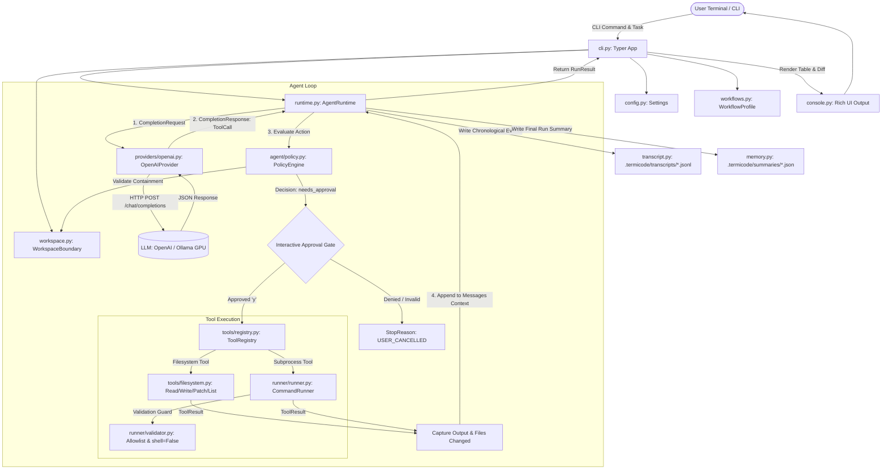

# TermiCode AI: System Architecture & Technical Portfolio Documentation

**Author / Candidate:** Bhavesh Bargat  
**Repository:** [https://github.com/Bhaveshbargat1/Termicode_AI](https://github.com/Bhaveshbargat1/Termicode_AI)  
**Package:** `termicode` (v0.1.0)  
**Target Roles:** AI Engineer | AI/ML Engineer | Software Engineer | Python Systems Architect  

---

## 1. Project Overview

### 1.1 Project Name & Version
- **Project Name:** TermiCode AI
- **Package Name:** `termicode`
- **Release Version:** `0.1.0` (Production-ready MVP)

### 1.2 Project Purpose
TermiCode AI is a secure, bounded terminal coding assistant built on the architectural principle of **deterministic authority separation**. It bridges generative Large Language Models (LLMs) with local software development workflows while eliminating the security risks associated with autonomous code execution.

### 1.3 The Problem It Solves
Traditional autonomous AI coding agents often operate with dangerous operational assumptions:
1. **Unbounded System Access:** Handing an LLM direct shell execution (`os.system` or `shell=True`) exposes developer environments to destructive commands (`rm -rf /`, formatting disks, killing processes).
2. **Path Traversal Vulnerabilities:** Lack of path sanitization allows agents to access sensitive files outside the designated repository (e.g., `~/.ssh/id_rsa`, `/etc/passwd`, `~/.aws/credentials`).
3. **Runaway Loops & API Cost Explosion:** Uncontrolled recursive loops without strict step budgets or repair caps lead to infinite token consumption and financial waste.
4. **Credential Leakage:** Debug outputs, tracebacks, and tool execution logs frequently leak sensitive API tokens and environment secrets into persistent disk storage.
5. **Lack of Human-in-the-Loop Governance:** Autonomous agents frequently apply destructive file writes without presenting unified diff previews for explicit developer authorization.

### 1.4 Why TermiCode AI is Useful in the Real World
TermiCode AI enables enterprise and security-sensitive developers to leverage the reasoning capabilities of state-of-the-art LLMs (cloud-based OpenAI or local privacy-first Ollama models on consumer GPUs) while guaranteeing that:
- File writes are strictly confined to an approved workspace boundary.
- Mutating actions require explicit human authorization with visual unified diff previews.
- Subprocesses are strictly restricted to an allowlist of vetted developer tools (`python`, `pytest`, `ruff`, `mypy`, `git`) executed without shell parsing (`shell=False`).
- Sensitive secrets and tokens are deterministically masked before hitting logs or disk transcripts.

### 1.5 Target Users
- **Software Engineers & Developers:** Automating test generation, codebase comprehension, bug diagnosis, and refactoring within local repositories.
- **Security-Conscious Teams:** Organizations requiring zero-telemetry, offline-first, or on-premises local AI code assistance.
- **DevOps & QA Engineers:** Performing automated, bounded code reviews and test suite verifications in CI/CD pipelines.

### 1.6 Main Engineering Objectives
1. **Enforce Deterministic Authority Separation:** The LLM proposes actions; deterministic Python software evaluates policy and authorizes execution.
2. **Guarantee Workspace Containment:** Canonical path resolution blocks all directory traversal attempts.
3. **Implement Resilient Error Recovery:** Bounded step budgets (8–12 steps) and consecutive repair counters (maximum 3 attempts) prevent runaway loops.
4. **Support Hybrid Inference Topologies:** Zero-dependency switching between Cloud OpenAI APIs, on-premises/local Ollama servers, and an in-memory deterministic offline engine.

---

## 2. Technology Stack

### 2.1 Technologies Actually Present in the Codebase

| Layer | Technology | Version | Purpose in TermiCode AI |
| :--- | :--- | :--- | :--- |
| **Language** | Python | `>=3.11` | Core language leveraging modern type unions, `match` statements, `asyncio`, and `StrEnum`. |
| **CLI Framework** | `typer` | `>=0.12.0` | Powers the command-line interface, subcommands (`run`, `understand`, `review`, etc.), option flags, and type-inferred arguments. |
| **Terminal UI** | `rich` | `>=13.0.0` | Renders color-coded status panels, execution summary tables, step telemetry, and unified diff syntax highlighting. |
| **Data Validation** | `pydantic` | `>=2.7.0` | Defines strict schema models, tool declarations, request/response validation, and JSON serialization. |
| **Configuration** | `pydantic-settings` | `>=2.2.0` | Automates loading environment variables with `TERMICODE_` prefix, `.env` file ingestion, and validation bounds. |
| **HTTP Transport** | Python Standard `urllib.request` | Built-in | Zero-dependency, lightweight HTTP client communicating with OpenAI and Ollama endpoints without external SDK baggage. |
| **File & Path Engine**| Python Standard `pathlib` | Built-in | Canonical path resolution (`Path.resolve()`), containment checks (`is_relative_to`), and POSIX normalization. |
| **Process Execution**| Python Standard `subprocess` | Built-in | Direct child process execution with `shell=False`, forced `cwd`, process timeouts, and buffer caps. |
| **Testing** | `pytest` | `>=8.0.0` | Automated test suite comprising 288 tests covering agent loops, policy rules, tools, and mock providers. |
| **Linting & Format** | `ruff` | `>=0.4.0` | High-performance linter and code formatter enforcing 100-character line lengths and clean Python idioms. |
| **Type Checking** | `mypy` | `>=1.10.0` | Strict static type analysis (`strict = true`) guaranteeing 100% type coverage across 38 source files. |
| **Build Backend** | `hatchling` | PEP 517/621 | Modern Python package build engine and wheel packaging specified in `pyproject.toml`. |

### 2.2 Why These Specific Technologies Were Chosen
- **Standard Library `urllib.request` over `openai` SDK or `requests`:** Eliminates bulky dependency graphs, avoids third-party version conflicts, and ensures TermiCode can communicate with *any* OpenAI-compatible server (vLLM, Ollama, OpenRouter) via raw HTTP.
- **`pydantic` v2 over raw dictionaries:** Guarantees runtime validation. If an LLM emits malformed arguments, Pydantic catches it deterministically, triggering a structured repair loop instead of crashing Python with a `KeyError`.
- **`typer` + `rich`:** Provides an accessible, developer-friendly terminal UX with human-readable color-coded diff previews, essential for safety approvals.
- **Flat-File JSON / JSONL over Relational Databases (SQLite/PostgreSQL):** For a local terminal assistant, audit logs must be zero-setup, inspectable with standard text editors, append-only, and easily versioned or deleted per workspace without requiring database migrations.

---

## 3. System Architecture

### 3.1 Architectural Philosophy: Deterministic Authority Separation
TermiCode AI separates the **Planner (Untrusted AI)** from the **Executor (Trusted Python Policy & Tools)**.

### 3.2 System Architecture Diagram (Mermaid)



### 3.3 Core Components & Responsibilities

1. **CLI Layer (`src/termicode/cli.py`, `console.py`)**
   - Entry point parsing commands, subcommands (`run`, `understand`, `review`, `generate`, `debug`, `tests`, `refactor`, `plan`, `status`, `runs`, `summary`, `transcript`), flags (`-p`, `-m`, `--offline`, `--dry-run`, `--yes`), and interactive fallback handling.
2. **Workspace Safety Boundary (`src/termicode/workspace.py`)**
   - Anchors all file operations to the canonical project root using `Path.resolve()`. Detects directory traversal attacks (`WorkspaceEscapeError`) and blocks sensitive credential paths (`SensitivePathError`).
3. **Workflow Specification (`src/termicode/agent/workflows.py`)**
   - Defines 6 workflow profiles with explicit step budgets, system prompts, allowed tools, and risk ceilings (e.g., read-only isolation for `understand` and `review`).
4. **Agent Runtime Loop (`src/termicode/agent/runtime.py`)**
   - Manages the execution state machine, iterates through step budgets, invokes providers, evaluates policy decisions, tracks repair attempts, and handles tool feedback.
5. **Policy Engine (`src/termicode/agent/policy.py`)**
   - Enforces human approval gating on mutating actions (`RiskLevel.WRITE`, `RiskLevel.EXECUTE`) and validates tool permissions against the active workflow profile.
6. **Tool Registry & Execution (`src/termicode/tools/`)**
   - Maintains typed tool definitions (`BaseTool`), generates OpenAI-compatible JSON function schemas, validates input arguments via Pydantic, and executes filesystem operations.
7. **Secure Command Runner (`src/termicode/runner/`)**
   - Subprocess executor enforcing `shell=False`, forced `cwd`, an allowlist of 5 executables (`python`, `pytest`, `ruff`, `mypy`, `git`), 30-second execution timeouts, and 64 KB output buffer caps.
8. **Provider Adapters (`src/termicode/providers/`)**
   - Abstract adapter layer supporting OpenAI Cloud, local Ollama endpoints (auto-detected on `http://localhost:11434/v1`), and an in-memory `FakeProvider`. Includes automated secret redaction (`redaction.py`).
9. **Local Memory & Auditing (`src/termicode/agent/memory.py`, `transcript.py`)**
   - Flight-recorder subsystem storing JSONL event streams and serialized `RunSummary` files under `<workspace>/.termicode/`.

---

## 4. End-to-End Working Process

```text
Step 01: CLI Ingestion & Argument Parsing
         User executes: termicode generate "create src/utils/math_helper.py"
         Typer maps CLI arguments to `generate()` in cli.py, routing to `_execute_workflow()`.

Step 02: Canonical Boundary Initialization
         WorkspaceBoundary resolves target directory using `Path(target).resolve()`.
         Ensures target exists and is a directory. Prepares `.termicode/` metadata path.

Step 03: Workflow Profile Loading
         Retrieves `generate` profile:
         - Allowed Risk Levels: READ, WRITE
         - Step Budget: 12 steps
         - System Prompt: Instructions emphasizing clean, typed Python implementation.

Step 04: Provider Initialization & Connectivity Fallback
         Checks provider settings (CLI flag > env var > Settings default).
         - If Ollama is chosen, probes `http://localhost:11434/v1/models` (1.5s probe).
         - If OpenAI is chosen without `OPENAI_API_KEY`:
           * Non-interactive mode: Exits with code 1 (`ProviderAuthError`).
           * Interactive terminal: Prompts user: "Would you like to run with offline engine? [Y/n]".
             On Enter/y, activates smart context-aware offline provider.

Step 05: Agent State & Context Assembly
         AgentRuntime initializes `AgentState`:
         - Message 1 (System): Profile system prompt.
         - Message 2 (User): User task string.
         Filters registered tools by allowed risk level (`list_files`, `read_file`, `search_text`, `write_file`).
         Extracts Pydantic JSON schemas via `args_schema.model_json_schema()`.

Step 06: Iterative Model Invocation (Step 1)
         Runtime packages `CompletionRequest(messages=state.messages, tools=schemas)`.
         OpenAIProvider formats messages and tool definitions into OpenAI wire format.
         Dispatches HTTP POST to `/chat/completions` via `urllib.request.urlopen()`.

Step 07: Response Parsing & Tool Call Extraction
         Model returns HTTP 200 with JSON payload containing `tool_calls`:
         `ToolCall(id="call_01", name="write_file", arguments={"path": "src/utils/math_helper.py", "content": "..."})`.
         (If local LLM emitted JSON inside text content, `_extract_fallback_tool_call` extracts it resiliently).

Step 08: Policy Evaluation & Safety Gating
         Runtime constructs `ProposedAction(tool_name="write_file", arguments=...)`.
         PolicyEngine evaluates action:
         - Is tool permitted in `generate` workflow? -> Yes.
         - Is target path inside workspace? -> Yes.
         - What is the risk level? -> `RiskLevel.WRITE`.
         Returns `PolicyDecision(status="needs_approval", preview="<unified diff>")`.

Step 09: Interactive Human Approval Gate
         Runtime invokes CLI approval callback (`make_cli_approval_handler`):
         - Formats workspace-relative target path: `src/utils/math_helper.py`.
         - Generates unified diff using Python `difflib`.
         - Renders color-coded Rich panel with red deletions and green additions.
         - Prompts user: `Approve action? [y/N]:`.
         User inputs `y` -> Approval confirmed (`user_approved = True`).
         (Any input other than 'y'/'yes' defaults to strict DENY, halting execution).

Step 10: Deterministic Tool Execution
         Runtime calls `ToolRegistry.execute("write_file", arguments, context=tool_ctx)`.
         `WriteFileTool._execute()` ensures parent directory `src/utils/` exists and writes file.
         Returns `ToolResult(ok=True, output="File written successfully", changed_files=["src/utils/math_helper.py"])`.

Step 11: Transcript Auditing & State Progression
         TranscriptWriter appends `tool_execution` event to `.termicode/transcripts/run_<id>.jsonl`
         with secrets deterministically scrubbed via `redact_secrets()`.
         Runtime updates `state.changed_files` and appends two messages to `state.messages`:
         1. Assistant message with `tool_calls`.
         2. Tool response message with `tool_call_id` and output content.

Step 12: Loop Continuation (Step 2)
         Runtime checks: `steps_used (1) < max_steps (12)`.
         Dispatches updated message context back to LLM provider.
         Model sees file was written successfully and concludes task without further tool calls.

Step 13: Session Termination & Final Reporting
         Runtime detects `len(response.tool_calls) == 0`.
         Assigns `StopReason.COMPLETED`.
         Serializes `RunSummary` and writes to `.termicode/summaries/run_<id>.json`.
         CLI renders Rich Execution Summary table and Assistant Summary box. Process exits 0.
```

---

## 5. Feature Catalog

1. **Deterministic Authority Separation:** Model acts strictly as an untrusted planner proposing typed actions; deterministic Python software evaluates policy and authorizes execution.
2. **Workspace Boundary Confinement:** Anchors all operations inside project root using canonical path resolution (`resolve_safe`), blocking traversal attacks (`../../`).
3. **Sensitive File & Credential Masking:** Actively blocks access to `.env`, `.git`, SSH keys, and certificates via `is_sensitive()`.
4. **Interactive Human-in-the-Loop Approval:** Renders color-coded unified diff previews using `rich` and `difflib`, with fail-safe default-to-deny authorization.
5. **Subprocess Allowlisting (`shell=False`):** Executes allowlisted development binaries (`python`, `pytest`, `ruff`, `mypy`, `git`) directly without shell interpreters.
6. **Task-Tailored Workflow Profiles:** 6 specialized modes (`understand`, `review`, `generate`, `debug`, `tests`, `refactor`) enforcing strict step budgets and permission matrices.
7. **Hybrid Inference Topologies:** Zero-dependency switching between Cloud OpenAI APIs, on-premises local Ollama models on consumer GPUs, and an offline mock engine.
8. **Automated Secret Scrubbing:** Deterministically scrubs API keys and bearer tokens from all logs, error messages, and transcripts via `redact_secrets()`.
9. **Auditable JSONL Flight Recorder:** Appends timestamped events and run summaries to `.termicode/` for verifiable security audits.

---

## 6. AI Implementation Details

- **Integration Point:** Exclusively at the action proposal stage in `AgentRuntime.run()`.
- **Supported Models:** OpenAI Cloud (`gpt-4o-mini`, `gpt-4o`), Local Ollama models (`qwen2.5-coder:7b`, `deepseek-coder:6.7b`), and offline rule-based mock engine (`offline-engine-v1`).
- **Prompt Architecture:** Chronological sequence of `system` (workflow constraints), `user` (task description), `assistant` (structured tool calls), and `tool` (execution output).
- **Communication Protocol:** Standard library `urllib.request` dispatching HTTP POST requests to OpenAI-compatible `/chat/completions` endpoints.
- **Resilient Fallback Parsing:** `OpenAIProvider._extract_fallback_tool_call()` uses regex to parse markdown/XML tool calls emitted by open-weights local LLMs.
- **Deterministic Modules:** Workspace safety, policy evaluation, subprocess execution, tool dispatch, and transcript logging contain zero non-deterministic AI inference.

---

## 7. Folder Structure

```text
Termicode AI/
├── pyproject.toml              # Build specification, dependencies, entry points, tool configurations
├── README.md                   # Complete architectural overview and user documentation
├── .env.example                # Configuration template documenting supported environment variables
├── .gitignore                  # Git exclusion rules (.venv, .env, .termicode, caches)
├── generate_guide_pdf.py       # Standalone documentation generator script
├── TermiCode_Architecture_and_Workflow_Guide.pdf # Exported system guide
│
├── docs/                       # Formal technical documentation
│   ├── architecture.md         # Component model, authority separation, and task lifecycle
│   ├── safety.md               # Safety guarantees, containment mechanics, and known limitations
│   ├── threat-model.md         # Threat classifications, attack vectors, and sandbox reality
│   ├── workflows.md            # Workflow profile specifications and tool permission matrices
│   └── local-models.md         # Hardware benchmarks and local Ollama setup guide
│
├── src/termicode/              # Core application package
│   ├── __init__.py             # Package root; exports version and public APIs
│   ├── cli.py                  # Typer CLI application, commands, options, and UI orchestration
│   ├── config.py               # Pydantic Settings management and runtime configuration defaults
│   ├── console.py              # Rich console output helpers, status banners, and error formatters
│   ├── workspace.py            # WorkspaceBoundary: canonical resolution, traversal & sensitive checks
│   │
│   ├── agent/                  # Agent brain, state machines, and local memory
│   │   ├── __init__.py         # Subpackage exports
│   │   ├── memory.py           # LocalMemory: saves and queries run summaries and transcripts
│   │   ├── models.py           # Pydantic data schemas: AgentRequest, RunResult, StopReason, etc.
│   │   ├── policy.py           # PolicyEngine: rule evaluation, tool filtering, approval gating
│   │   ├── runtime.py          # AgentRuntime: bounded propose-validate-approve-execute loop
│   │   ├── transcript.py       # TranscriptWriter: append-only redacted JSONL logging
│   │   └── workflows.py        # WorkflowProfile registry (6 profiles)
│   │
│   ├── providers/              # LLM communication adapters
│   │   ├── __init__.py         # Subpackage exports
│   │   ├── base.py             # LLMProvider abstract interface, ChatMessage, ToolCall schemas
│   │   ├── fake.py             # FakeProvider: deterministic mock provider for testing
│   │   ├── openai.py           # OpenAIProvider: HTTP adapter for OpenAI and Ollama endpoints
│   │   └── redaction.py        # SecretRedactor: regex scrubbing of API keys and bearer tokens
│   │
│   ├── runner/                 # Subprocess security layer
│   │   ├── __init__.py         # Subpackage exports
│   │   ├── runner.py           # CommandRunner: subprocess.run(shell=False) with timeouts
│   │   └── validator.py        # validate_command: allowlist verification & shell metacharacter blocking
│   │
│   └── tools/                  # Deterministic tool implementations
│       ├── __init__.py         # Subpackage exports
│       ├── base.py             # BaseTool abstract class, RiskLevel enum, ToolResult model
│       ├── command.py          # RunCommandTool: allowlisted external command execution
│       ├── filesystem.py       # ListFiles, ReadFile, SearchText, WriteFile, ApplyPatch tools
│       └── registry.py         # ToolRegistry: registration, schema export, and dispatch
│
└── tests/                      # 288 Automated tests
    ├── __init__.py
    ├── test_agent.py           # Loop bounds, repair limits, direct completions, approval denial
    ├── test_cli.py             # Commands, options, dry-run, approval prompts, offline execution
    ├── test_config.py          # Settings defaults, environment overrides, validation bounds
    ├── test_filesystem_tools.py# Read, write, patch, list, search, size limits, binary detection
    ├── test_memory.py          # Transcript logging, summary persistence, corruption handling
    ├── test_policy.py          # PolicyEngine evaluations across workflows and risk levels
    ├── test_providers.py       # OpenAIProvider serialization, Ollama probe, error normalization
    ├── test_runner.py          # CommandRunner allowlist, shell metacharacter blocking, timeouts
    ├── test_strengthening.py   # Secret redaction, read-only workflow tool exclusions
    ├── test_tools.py           # ToolRegistry duplicate checks, schema generation, dispatch
    ├── test_workflows.py       # Workflow profile completeness and permission isolation
    └── test_workspace.py       # Path traversal attacks, canonicalization, sensitive file blocking
```

---

## 8. Deep-Dive Implementation Details

- **`WorkspaceBoundary.resolve_safe(target, allow_sensitive=False)`:** Converts relative/absolute paths to canonical paths via `Path.resolve()`, verifies `is_relative_to(root)` (raising `WorkspaceEscapeError` on escapes), and checks `is_sensitive()` (raising `SensitivePathError` on `.env`, `.git`, or key files).
- **`AgentRuntime.run(request)`:** Central execution state machine. Implements a bounded loop (`steps_used < max_steps`), handles model proposals, policy evaluation, interactive approvals, tool dispatch via `ToolRegistry`, output truncation (16,384 characters), and automatic repair limits (maximum 3 consecutive failures).
- **`validate_command(command, workspace)`:** Checks proposed command arrays against `ALLOWED_EXECUTABLES` (`python`, `pytest`, `ruff`, `mypy`, `git`), restricts `git` to read-only subcommands, restricts `python -m` to approved testing modules, and blocks shell metacharacters (`|`, `;`, `&&`, `$()`).
- **`OpenAIProvider.complete(request)`:** Builds JSON payloads, dispatches HTTP POST via `urllib.request`, sanitizes errors via `redact_secrets()`, normalizes HTTP codes to typed domain errors (`ProviderAuthError`, `ProviderRateLimitError`, etc.), and extracts structured `tool_calls`.

---

## 9. Security, Error Handling & Limitations

- **Defenses Implemented:** Canonical path validation, sensitive credential blocking, `shell=False` execution, executable allowlisting, interactive diff approvals with default-to-deny, process timeouts (30s), output buffer limits (64 KB), step/repair budgets, automated secret scrubbing.
- **Known Limitations:** No OS-level kernel isolation (no Docker/seccomp containers); network sockets in user-approved test scripts are not blocked; security relies on developer verification before approving diffs.

---

## 10. Testing, Quality & Performance Verification

- **Automated Tests:** 288 tests in test suite; **287 passed, 1 skipped** (live Ollama daemon test) in ~9.5s.
- **Static Type Analysis:** 100% strict `mypy` typing with zero errors across 38 source files.
- **Code Style & Linting:** 100% clean under `ruff` with 100-character line limit.

---

## 11. Engineering Contributions & Demonstrated Skills

- **Autonomous Agent Systems:** Event-driven propose-validate-approve-execute state machine with bounded loops.
- **Application Security Engineering:** Authority separation, path traversal defenses, shell injection mitigation.
- **Zero-Dependency Networking:** Pure Python standard library HTTP client for OpenAI-compatible inference.
- **Terminal User Interface Design:** Interactive approval workflows with visual diff previews and ANSI telemetry.
- **Rigorous Software Testing:** 288-test regression suite with strict typing and deterministic mock testbeds.

---

## 12. Resume-Ready Descriptions & Portfolio Highlights

### Professional Project Description (2–3 Lines)
> **TermiCode AI** is an open-source, bounded terminal coding assistant built with Python and Typer that enforces deterministic authority separation between Large Language Model planners and local system execution. It enables safe local code generation, debugging, and testing through canonical workspace confinement, unified diff approval gates, and allowlisted subprocess sandboxing supporting cloud and local (Ollama) inference.

### High-Impact Technical Resume Bullet Points
- **Architected a secure, bounded AI agent runtime** in Python 3.11 with an event-driven propose-validate-approve-execute loop, enforcing strict step budgets and automatic repair cycles across 6 distinct workflow profiles.
- **Engineered deterministic security guardrails** utilizing `pathlib` canonicalization to prevent path traversal attacks and subprocess execution with `shell=False` to eliminate shell injection vulnerabilities.
- **Built a zero-dependency OpenAI-compatible provider adapter** using standard library `urllib.request`, enabling seamless switching between OpenAI cloud APIs, local GPU-accelerated Ollama models, and an offline testbed.
- **Implemented interactive human-in-the-loop approval gates** with `rich` and `difflib`, rendering visual unified diff previews with fail-safe default-to-deny authorization and automated secret redaction.
- **Achieved 100% test pass rate across 288 automated pytest suites** and zero static analysis issues under strict `mypy` typing and `ruff` linting across 38 source files.

### ATS-Friendly Technical Skills & Keywords
- **Languages:** Python (3.11+), Bash, PowerShell, SQL.
- **AI & LLM Technologies:** Agentic Workflows, Function Calling / Tool Calling, Ollama, OpenAI API, Prompt Engineering, Token Budgeting, Local Model Deployment, Qwen2.5-Coder.
- **Architecture & Security:** Deterministic Policy Enforcement, Path Traversal Defense, Shell Injection Mitigation, Secret Redaction, Authority Separation, Sandboxing, Human-in-the-Loop (HITL).
- **Libraries & Frameworks:** Typer, Rich, Pydantic (v2), Pydantic-Settings, Pytest, Mypy, Ruff, Hatchling.
- **Systems & DevOps:** Subprocess Management, Virtual Environments (`venv`), POSIX Path Normalization, Git Version Control, CI/CD Readiness.

---

## 13. Technical Interview Preparation (15 Questions & Answers)

1. **What is "authority separation" in TermiCode AI?**  
   *Answer:* The LLM acts as an untrusted planner that can only suggest actions in structured JSON. Deterministic Python policy code verifies that the action is safe and asks the developer for confirmation before any tool modifies files or runs processes.
2. **Why did you implement `shell=False` in subprocess execution?**  
   *Answer:* Using `shell=False` and passing arguments as an explicit array of strings (`["pytest", "-v"]`) ensures the operating system treats every token literally, completely eliminating command injection attacks like `; rm -rf /`.
3. **How do you prevent an AI model from reading files outside the project directory?**  
   *Answer:* `WorkspaceBoundary.resolve_safe()` canonicalizes target paths with `Path.resolve()`, resolving symlinks and `../` traversals, and verifies `resolved.is_relative_to(root)`, raising `WorkspaceEscapeError` on escapes.
4. **Why build an OpenAI-compatible adapter with `urllib.request` instead of the official OpenAI SDK?**  
   *Answer:* To eliminate heavy transitive dependencies and version conflicts. Standard library `urllib.request` communicates directly with any OpenAI-compatible endpoint (OpenAI, Ollama, vLLM) via raw HTTP.
5. **What happens if an AI agent gets stuck in an infinite repair loop?**  
   *Answer:* The `AgentRuntime` enforces `max_steps` (8–12 steps) and `max_repairs` (maximum 3 consecutive repair attempts). On the 4th failure, it halts with `StopReason.MAX_REPAIRS_REACHED`.
6. **What is the purpose of the 6 workflow profiles?**  
   *Answer:* To enforce the principle of least privilege. In read-only profiles like `understand` and `review`, mutating tools (`write_file`, `apply_patch`, `run_command`) are completely excluded from tool declarations and rejected by policy.
7. **How does your tool registry connect to the AI model?**  
   *Answer:* Tools inherit from `BaseTool` and define a Pydantic `args_schema`. The registry calls `args_schema.model_json_schema()` to export OpenAI-compatible JSON function definitions sent in API requests.
8. **How does the interactive approval gate protect against accidental file overwrites?**  
   *Answer:* For mutating tools (`write_file`, `apply_patch`), the CLI computes a unified diff using `difflib`, displays it in a colored Rich panel, and defaults any input other than `y` strictly to **DENY**.
9. **What happens if TermiCode runs in a non-interactive CI/CD pipeline?**  
   *Answer:* `cli.py` checks `sys.stdin.isatty()`. In non-interactive or piped sessions, approval prompts default to **DENY** unless explicitly run with `--yes`, preventing pipelines from hanging.
10. **How do you protect sensitive credentials like `.env` files from being exposed to the AI?**  
    *Answer:* `WorkspaceBoundary.is_sensitive()` blocks access to `.env`, `.git`, SSH keys, and certificates, raising `SensitivePathError`. Additionally, `redact_secrets()` masks API keys before writing transcripts.
11. **How does the application handle local models that output tool calls in markdown rather than JSON?**  
    *Answer:* `OpenAIProvider._extract_fallback_tool_call()` uses regular expressions to capture `<tool_call>` or ````json blocks and parse them into standard `ToolCall` objects.
12. **Why choose flat-file JSONL transcripts over an SQLite database?**  
    *Answer:* JSON Lines allows append-only logging in under a millisecond without database locks, is human-readable in any text editor, zero-configuration, and easily versioned per repository.
13. **What are the command execution restrictions in `validate_command`?**  
    *Answer:* Only 5 executables are allowlisted (`python`, `pytest`, `ruff`, `mypy`, `git`). Git commands are restricted to read-only subcommands, and Python is limited to approved test/lint modules.
14. **What is the purpose of the `--offline` flag?**  
    *Answer:* It connects to `_create_smart_offline_provider()`, which dynamically inspects workspace files and produces typed Python implementations and architecture reports with zero external dependencies.
15. **What are the honest security limitations of TermiCode AI?**  
    *Answer:* TermiCode provides application-level boundaries, not kernel-level virtualization (no Docker/seccomp). Approved commands run under the user account, and safety relies on developer verification before approving diffs.

---

## 14. Final Technical Summary

- **Project Name:** TermiCode AI (`termicode` v0.1.0)
- **Problem Statement:** Autonomous AI coding tools present severe security risks by granting untrusted LLMs unbounded shell execution and unrestricted filesystem access.
- **Solution:** A bounded terminal coding assistant enforcing deterministic authority separation, canonical workspace confinement, unified diff approval gates, and allowlisted subprocess sandboxing.
- **Architecture:** Layered propose-validate-approve-execute state machine separating untrusted LLM planners from deterministic Python policy evaluators.
- **Technology Stack:** Python 3.11, Typer, Rich, Pydantic v2, Pydantic-Settings, Pytest, Ruff, Mypy, Hatchling.
- **AI Integration:** OpenAI-compatible REST API client supporting Cloud OpenAI (`gpt-4o-mini`), local GPU inference via Ollama (`qwen2.5-coder:7b`), and an in-memory offline mock provider.
- **Key Features:** Canonical path containment, credential blocklisting, `shell=False` allowlisting, 6 workflow profiles, visual diff reviews, JSONL audit logs, and secret redaction.
- **Quality Benchmarks:** 288 automated pytest suites (287 passed, 1 skipped), 100% strict Mypy typing, zero Ruff linter warnings across 38 source files.
- **Resume Impact:** Demonstrates professional competence in software architecture, application security, LLM tool integration, and high-standard Python engineering.
